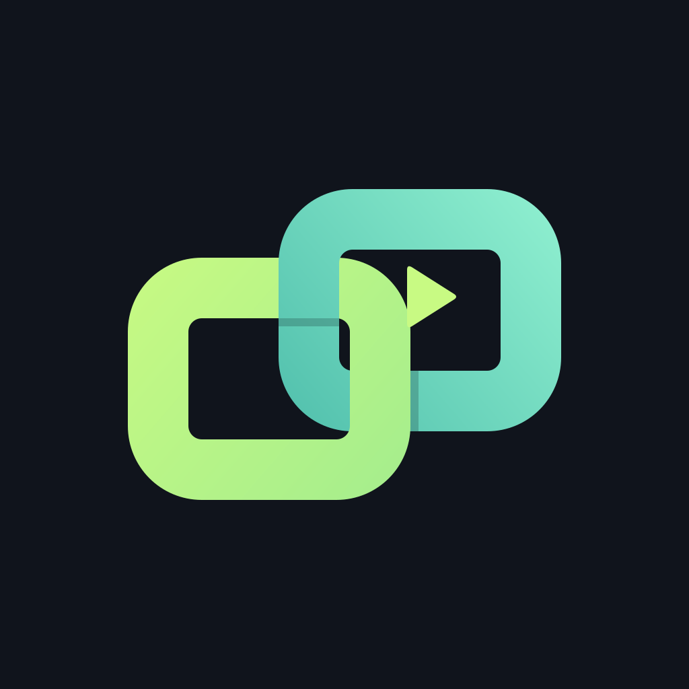

# FlowCast

FlowCast 是一个把电脑与手机连接成统一录制工作台的开源项目。它支持电脑屏幕、手机屏幕、电脑摄像头和手机前摄像头的组合预览，也支持手机麦克风、布局切换、暂停续录和 WebM/MP4 导出。

项目由 Windows 电脑端、浏览器工作台、Android 伴侣应用和可选的远程信令服务组成。

## 功能

- 单画面、画中画、左右分屏和四宫格布局
- 在录制过程中切换来源，支持渐变或直接切换
- 手机屏幕、前摄像头和麦克风共享
- 录制前的音量电平和手机声音试听
- 暂停后继续同一段录制
- 局域网二维码配对
- 可选的跨网络连接：使用自有 HTTPS 信令服务和 STUN/TURN
- Windows 桌面程序自动管理端口，支持安装包和免安装 ZIP

## 快速开始

### Windows 软件

如果仓库 Releases 已提供安装包，可下载安装程序，或解压 ZIP 后运行 `FlowCast.exe`。程序会自动启动本机服务并打开工作台，不需要 Node.js 或手动查找端口。

### 从源码运行

需要 Node.js 20 或更新版本。在仓库根目录执行：

~~~powershell
npm install
npm start
~~~

然后打开终端输出的工作台地址，默认是 `http://localhost:4310`。开发桌面入口使用：

~~~powershell
npm run desktop
~~~

端口被占用时，服务会自动选择空闲端口；请使用启动日志中的实际地址。手机和电脑在局域网模式下需要连接同一个 Wi-Fi 或热点。

### Android

使用 Android Studio 或 `scripts/setup-android.ps1` 准备 JDK 17、Gradle 8.13 和 Android SDK。安装 Android 应用后，在电脑工作台显示二维码，打开手机的“扫描电脑二维码”完成配对。首次使用需要批准屏幕采集、相机和麦克风权限。

## 跨网络连接

不同网络之间不能直接依赖局域网二维码发现。项目提供 `remote/` 下的信令与 TURN 部署模板，部署到你自己管理的公网主机后，电脑和手机都可以通过互联网配对。需要公网 HTTPS 域名、可访问的 STUN/TURN，以及相应的防火墙规则；仓库没有附带公共服务器。

完整配置见 [remote/README.md](remote/README.md)。远程服务只负责配对和 WebRTC 连接协商，录像仍保存在电脑上。

## 开发与测试

~~~powershell
npm test
npm run test:browser
npm run test:scanner
npm run test:remote:browser
npm run dist:win
~~~

Windows 打包和 Android 构建说明分别见 [desktop/WINDOWS.md](desktop/WINDOWS.md) 和 [DEVELOPMENT.md](DEVELOPMENT.md)。

手机系统声音采集尚未实现。手机麦克风默认不在电脑扬声器播放；需要试听时，在“声音”面板手动开启“监听手机声音”。关闭监听仍可录入手机声音。当前 Windows 包未配置发布者签名；真机、移动网络和长时间运行仍需验证。

## 数据与隐私

局域网配对记录和证书保存在本机，录像保存在电脑。跨网服务在内存中保存配对房间和连接状态；视频可能经 TURN 转发。不要提交 `.flowcast/`、`.env`、录像、调试输出、签名文件或构建目录。发布前可以运行：

~~~powershell
node scripts/export-public.mjs
~~~

脚本会按允许列表生成一个不含本机数据和依赖缓存的源码发布目录。

## 许可

本项目原创代码和文档使用 [MIT License](LICENSE)。依赖项及可选的打包组件保留各自许可证，详见 [THIRD_PARTY_NOTICES.md](THIRD_PARTY_NOTICES.md)。
